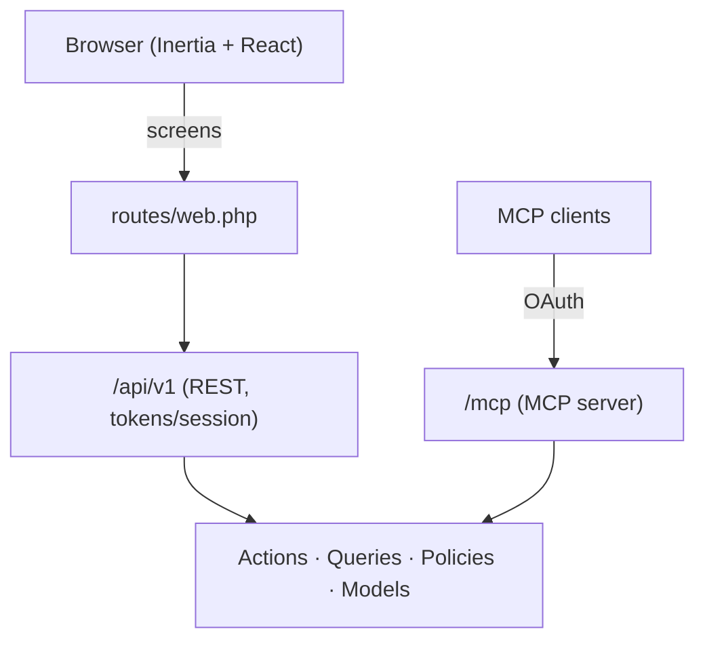

# Corpus

Corpus is a minimal, self-hosted workspace for writing and diagramming. Teams write **pages** and sketch **boards** together in shared **spaces**, on infrastructure the organization controls.

Most team knowledge ends up in hosted tools that the organization cannot inspect, export cleanly, or automate without friction. Corpus takes the opposite approach. The data stays on your servers. Admins can see who did what. Anything a person can do in the UI, a script or an AI agent can do through the API.

- **API-first.** The web app is a client of the same REST API you get. It ships with OpenAPI docs, scoped personal access tokens, and OAuth.
- **Pages and boards are equals.** Pages are rich text stored as markdown. Boards are shapes, connectors, and text on a canvas, stored as JSON. Neither is nested inside the other.
- **Agent-ready.** A built-in [MCP](#mcp-server) server lets AI clients search, read, and edit pages under OAuth.
- **Auditable.** Admins manage users and review an audit log of changes.

Also included: versioned history with restore, inline notes and tasks (notations) with replies and an inbox, file attachments, trash with 30-day retention, and title search.

## Architecture

The web app only renders screens. Every write goes through the REST API. The REST API and the MCP server call the same domain layer.



| Path | Contents |
| --- | --- |
| `app/Actions` | One class per operation (shared by API, MCP, and UI) |
| `app/Queries` | List and query objects |
| `app/Policies` | Authorization, including space roles |
| `app/Http/Controllers/Api/V1` | REST controllers |
| `app/Mcp` | MCP server and tools |
| `app/Models` | `Space`, `Page` (pages and boards), `PageVersion`, `Notation`, `Attachment`, `AuditLog`, `User` |
| `resources/js/pages` | Inertia pages |
| `resources/js/components` | `ui`, `editor` (Tiptap), `board` (React Flow), `notations` |
| `resources/js/actions`, `routes` | Generated by Wayfinder; do not edit |
| `tests/Feature`, `tests/Unit` | PHPUnit tests |

Pages and boards share one table, split by `PageType`, but they have separate routes and resources. A mixed search covers both.

Spaces have a visibility (open, visible, private) and member roles (manager, editor, viewer). Each user gets a personal space.

## Stack

| Layer | Technology |
| --- | --- |
| Backend | PHP 8.3+ (Sail runs 8.5), Laravel 13 |
| Frontend | Inertia 3, React 19, TypeScript, Tailwind 4 |
| Editor / canvas | Tiptap 3, React Flow (`@xyflow/react` 12) |
| Auth | Fortify (two-factor, passkeys, email verification), Passport 13 |
| MCP | `laravel/mcp` |
| API docs | Scramble (OpenAPI 3.1) |
| Routes in TS | Wayfinder |
| Quality | Pint, Larastan (level 7), PHPUnit 12 |
| Dev environment | Laravel Sail |

## REST API

Base path: `/api/v1`. Every route requires an authenticated, verified user and is throttled to 600 requests per minute.

**Auth.** Send a personal access token as a bearer token. Create tokens in **Settings → API tokens** (requires password confirmation). Browser sessions used by the web app are not scope-limited.

**Scopes.** `profile:read`, `pages:read`, `pages:write`, `notations:read`, `notations:write`, `spaces:read`, `spaces:write`, `attachments:read`, `attachments:write`, `admin:read`, `admin:write`. The `admin:*` scopes are limited to admins.

**Resources.** `me`, `meta`, `search`, `pages`, `boards`, `notations`, `attachments`, `spaces`, `admin/users`, `admin/audit-log`. Pages and boards each support versions, restore, trash, and force delete.

**Docs.** Signed-in users can open `/docs/api` (UI) and `/docs/api.json` (OpenAPI document).

```bash
curl -H "Authorization: Bearer $TOKEN" -H "Accept: application/json" \
  https://corpus.example.com/api/v1/search?q=roadmap
```

## MCP server

Endpoint: `/mcp`. Clients authenticate with OAuth and the `mcp:use` scope. That scope is only issued through OAuth, never through a personal access token.

- **Discovery:** RFC 9728 and RFC 8414 metadata documents.
- **Registration:** dynamic client registration at `POST /oauth/register` (10 requests per minute). Redirect URIs must be `https`, or `http` on loopback. Extra custom schemes go in `config/mcp.php`.
- **Tokens:** access tokens last 1 hour, refresh tokens 30 days.
- **Origins:** browser requests from origins other than `APP_URL` must be listed in `MCP_ALLOWED_ORIGINS`.

| Tool | Purpose |
| --- | --- |
| `search`, `fetch` | Find and read content |
| `create_page`, `update_page` | Write pages (not boards). `update_page` takes `base_updated_at` and rejects stale writes |
| `trash` | Move content to trash |
| `list_spaces` | List accessible spaces |
| `list_notations`, `add_notation`, `complete_notation` | Work with inline notes and tasks |
| `list_versions`, `restore_version` | Read history and roll back |

## Getting started

Requires Docker.

```bash
cp .env.example .env
vendor/bin/sail up -d
vendor/bin/sail artisan key:generate
vendor/bin/sail artisan passport:keys
vendor/bin/sail artisan migrate --seed
vendor/bin/sail npm install
vendor/bin/sail npm run dev
```

The app runs at http://localhost. `.env.example` defaults to SQLite. To use the Sail MySQL service, uncomment and set the `DB_*` values.

The seeder creates an owner account, `test@example.com` with password `password`. Mail uses the `log` driver, so verification links appear in `storage/logs`.

## Configuration

| Variable | Purpose |
| --- | --- |
| `APP_URL` | Public URL. Also the default allowed MCP origin |
| `MCP_ALLOWED_ORIGINS` | Extra browser origins allowed to call `/mcp` |
| `ATTACHMENTS_DISK` | Filesystem disk for attachments (default `local`). Files are served through the app, not directly |
| `AUDIT_RETENTION_DAYS` | Days to keep audit rows. Unset keeps them forever |
| `API_VERSION` | Version shown in the OpenAPI document |
| `DB_*`, `AWS_*`, `MAIL_*` | Database, S3 storage, and mail |

Sessions, cache, and queue all use the database driver by default.

## Checks

```bash
vendor/bin/sail composer test        # Pint, PHPStan, then PHPUnit
vendor/bin/sail composer lint        # fix style
vendor/bin/sail npm run check        # frontend lint/format
vendor/bin/sail npm run types:check  # tsc --noEmit
vendor/bin/sail composer ci:check    # everything CI runs
```

Run one test: `vendor/bin/sail artisan test --compact --filter=testName`.

CI (`.github/workflows/tests.yml`) runs `composer setup` and `composer ci:check` on PHP 8.3 and Node 22.

## Deployment

The project targets [Laravel Cloud](https://cloud.laravel.com/). On any host, you need:

- `APP_URL` set to the public HTTPS URL, and `MCP_ALLOWED_ORIGINS` if browser MCP clients are used.
- Passport keys. Run `php artisan passport:keys`, or publish the Passport config and set `PASSPORT_PRIVATE_KEY` and `PASSPORT_PUBLIC_KEY`. The keys are not in source control.
- A private attachments disk, such as S3, set with `ATTACHMENTS_DISK`.
- A queue worker, since the queue uses the database driver.
- The scheduler, which runs daily pruning: trashed pages, audit logs, expired Passport tokens, and stale MCP clients.
- A production asset build: `npm run build`.
